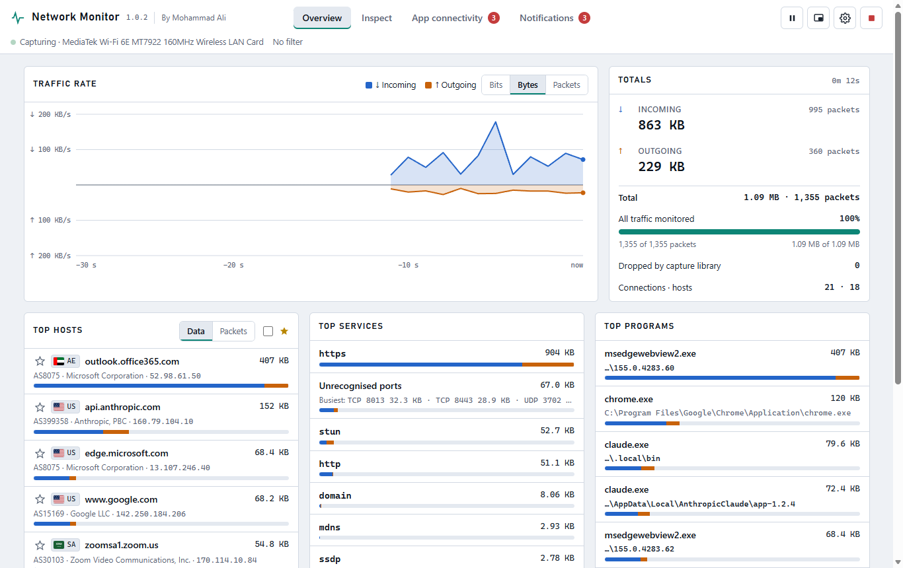
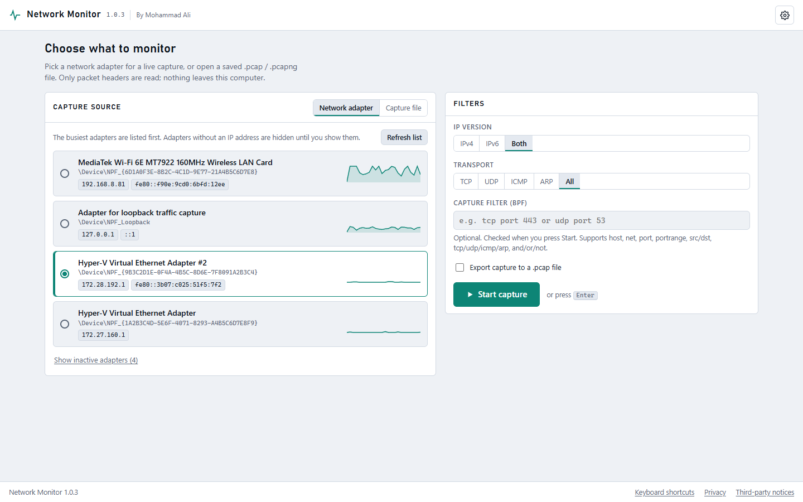
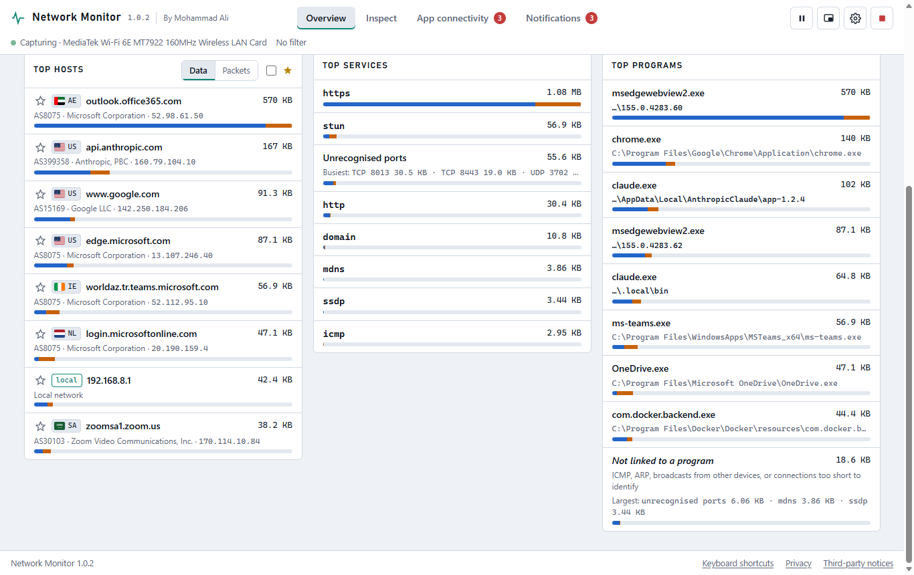
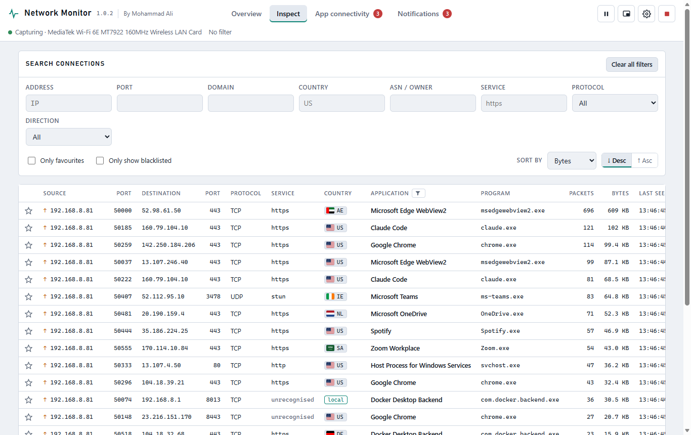
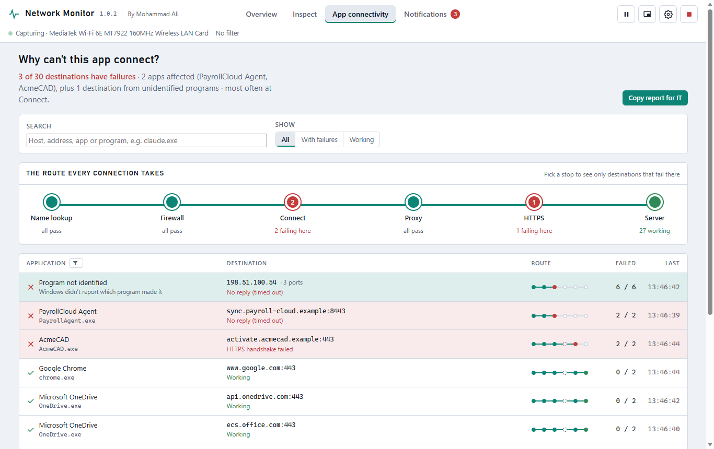
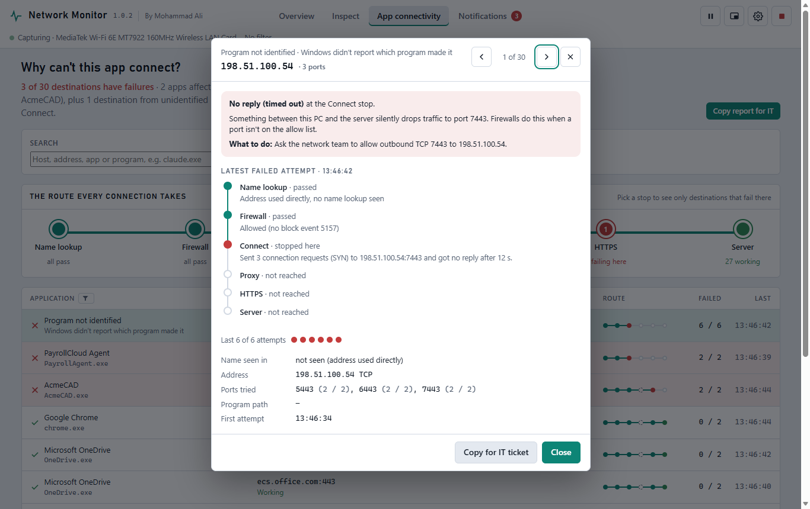
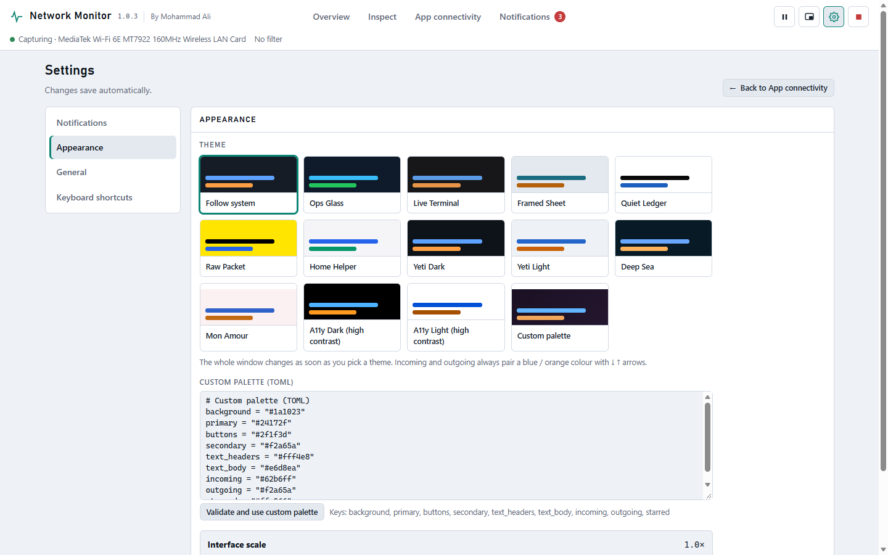
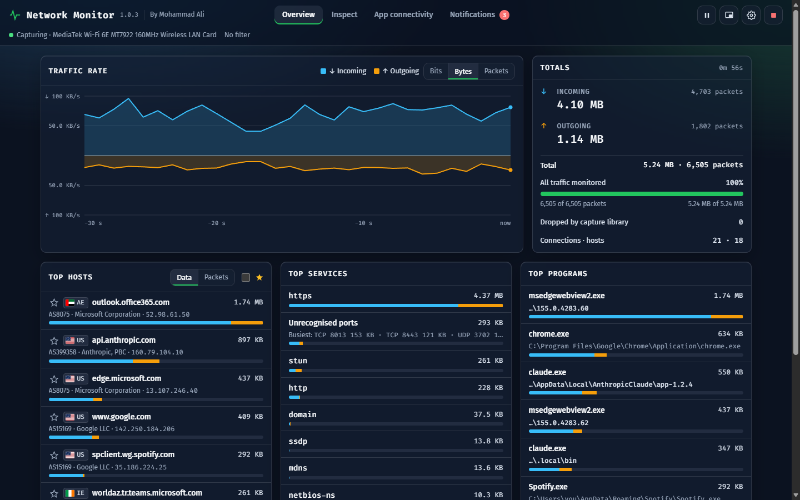
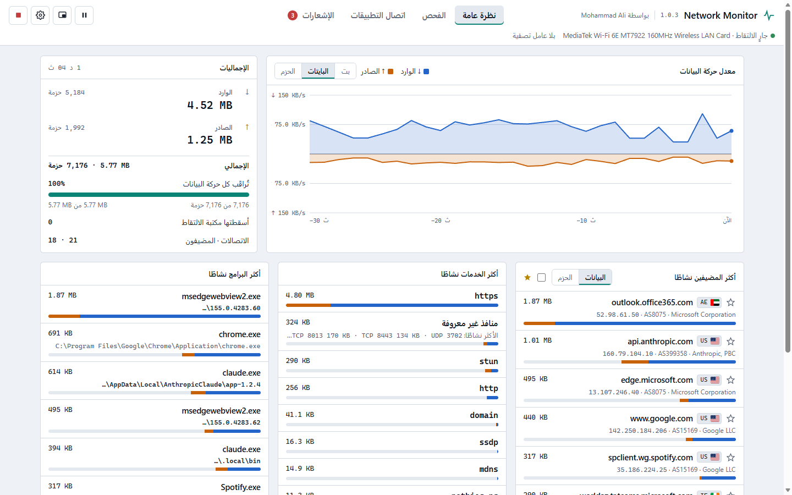

# Network Monitor

A Windows desktop app that shows what your PC is talking to on the network, and why an app can't connect.

By Mohammad Ali.

## Download

Get **NetworkMonitor-1.0.2-x64.msi** from the [Releases](../../releases) page and run it.

- Windows 10 or 11, 64-bit.
- Live capture needs the free [Npcap](https://npcap.com) driver. The installer offers to download it; saved `.pcap` / `.pcapng` files open without it.
- The installer is not code-signed yet, so Windows SmartScreen may warn before it runs.

SHA-256 of `NetworkMonitor-1.0.2-x64.msi`:

```
9F154BAD2049DC9746C8968CB38AA2EC59FA840F472F14E406268740FD5F84B3
```

## What it does

- **Overview:** live traffic chart, totals, and the busiest hosts (with country flag and network owner), services and programs.
- **Inspect:** every connection, with filters for address, port, country, service, program and direction.
- **App connectivity:** follows each connection through name lookup, Windows Firewall, connect, proxy and HTTPS, shows where it stops and what to do about it, and copies a report for IT.
- **Notifications:** data thresholds, favourite hosts, an IP blacklist, app connection failures, optional webhook.
- Pause and resume, thumbnail mode, English and Arabic (right-to-left), several themes including Ops Glass.

All analysis happens on your PC. There is no telemetry and no account.

## Screenshots

Version 1.0.2 running on sample traffic.

**Overview:** traffic chart, totals, top hosts, services and programs.



**Start page:** pick an adapter (busiest first) or open a capture file, with filters and optional export.



**Top hosts, services and programs:** country flags and network owners, "Unrecognised ports", programs grouped by file.



**Inspect:** every connection, with filters and sorting.



**App connectivity:** where each connection stops on its way out: name lookup, firewall, connect, proxy, HTTPS.



**Destination details:** what failed, the likely cause, what to do, and each step of the last attempt.



**Settings → Appearance:** themes, custom palette and interface scale.



**Ops Glass theme**



**Arabic:** the interface in Arabic, laid out right to left.



## 1.0.2 (test build)

Settings as a full page · English and Arabic · country flags and built-in location data (DB-IP Lite) · programs grouped by file path · "Not linked to a program" and "Unrecognised ports" breakdowns · App connectivity paging, search, details pop-up and per-server grouping · pause and resume · busiest adapters listed first · Ops Glass theme · security fixes.

## Licence

MIT, see [LICENSE](LICENSE).

## Third-party components

See [THIRD-PARTY-NOTICES.txt](THIRD-PARTY-NOTICES.txt). Location data: IP Geolocation by [DB-IP](https://db-ip.com), licensed under [CC BY 4.0](https://creativecommons.org/licenses/by/4.0/).
