# Network Monitor

A desktop app for Windows and macOS that shows what your computer is talking to on the network, and why an app can't connect.

By Mohammad Ali.

## Download

### Windows

Get **NetworkMonitor-1.0.4-x64.msi** from the [Releases](../../releases) page and run it. It replaces any earlier 1.0.x and keeps your settings.

- Windows 10 or 11, 64-bit.
- Live capture needs the free [Npcap](https://npcap.com) driver. The installer offers to download it; saved `.pcap` / `.pcapng` files open without it.
- The installer is not code-signed yet, so Windows SmartScreen may warn before it runs.

SHA-256 of `NetworkMonitor-1.0.4-x64.msi`:

```
B6366F8638E966EAD44C47CA6C8E52225A96BF7CD474CA89B57B171463673D34
```

### macOS

Get the installer for your Mac from the **Network Monitor 1.0.4 for macOS** release on the [Releases](../../releases) page:

- **NetworkMonitor-1.0.4-macOS-AppleSilicon.pkg** for Macs with an M1 chip or later
- **NetworkMonitor-1.0.4-macOS-Intel.pkg** for Intel Macs

Notes:

- macOS 13 Ventura or later. The app is installed in Applications.
- The installer isn't notarised by Apple yet, so macOS may refuse to open it at first. Control-click the .pkg and choose **Open**, or allow it in System Settings → Privacy & Security.
- On first start, allow **Network Monitor** in System Settings → General → Login Items. Its small helper lets the app capture without an administrator password and name the program behind each connection; Settings → General can remove it again. Saved `.pcap` / `.pcapng` files open without it.
- This is the first macOS build. It was tested on an Apple Silicon Mac; the Intel build hasn't been tried on an Intel Mac yet.

SHA-256:

```
12BF442C00D7E68A601B0C0E2B3BA1F6B0191A47951E15F6B24E555920DE8A6F  NetworkMonitor-1.0.4-macOS-AppleSilicon.pkg
DE92E0E920D25741D8D71931C03173312C0F1F7A15F9F9D50D09F6F4E9ADAF42  NetworkMonitor-1.0.4-macOS-Intel.pkg
```

## What it does

- **Overview:** live traffic chart, totals, and the busiest hosts (with country flag and network owner), services and programs.
- **Inspect:** every connection, with filters for address, port, country, service, program and direction, and a switch to show or hide Windows services.
- **App connectivity:** follows each connection through name lookup, Windows Firewall, connect, proxy and HTTPS, shows where it stops and what to do about it, and copies a report for IT.
- **Notifications:** data thresholds, favourite hosts, an IP blacklist, app connection failures, optional webhook. Each type can pop up or just be recorded.
- Pause and resume, thumbnail mode, English and Arabic (right-to-left), 13 themes.

All analysis happens on your computer. There is no telemetry and no account.

**On macOS** the screens, languages and themes are the same. The differences: a **Show system services** switch hides macOS's own background programs; the firewall step shows the macOS firewall's setting (it doesn't log each block); a menu-bar icon takes the place of the tray icon; notifications go to Notification Center; and shortcuts use ⌘.

## What's new in 1.0.4

### New feature: Show Windows services

Inspect and App connectivity have a new **Show Windows services** switch. Turn it off to hide svchost.exe and the other Windows system programs, so the lists show only your own apps. The switch says how many entries it is hiding, it works the same on both pages, and your choice is remembered. Totals, the chart and notifications still count everything.

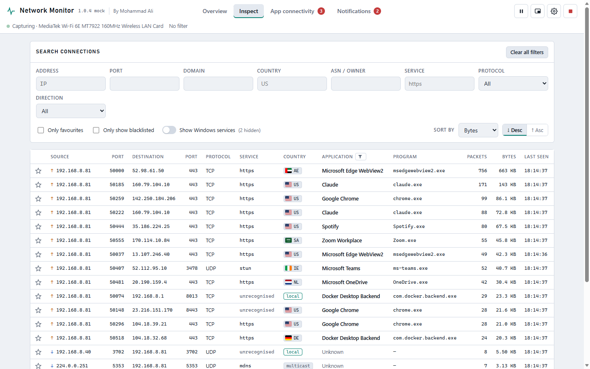

### Fixed

| Problem | Fixed in 1.0.4 |
|---|---|
| Network Monitor listed itself in App connectivity as an app with failing name lookups. | It now looks up host names in a way that doesn't create those failures, and it leaves its own lookups out of the list. |
| On the start page, with export turned on, the Browse… button could sit behind the file name box. | The folder box, Browse… and the file name now fit side by side at every window size. |

### Security hardening

A security review of 1.0.3 found no confirmed vulnerability, but ten places that could be made safer. All ten are addressed in 1.0.4. Most of them concern **Restart as administrator**: they stop another program running on your PC from using the administrator window to change protected files.

- **Settings and exports as administrator:** they are never written through redirected (linked) folders.
- **Npcap download:** the installer runs from a folder that other programs can't add files to, and it must be the version npcap.com offers, not an older one.
- **Install folder:** if you install somewhere other than Program Files, the folder now gets the same protection as Program Files.
- **Administrator window:** it ignores developer and browser settings that a normal program could change.
- **Report for IT:** names received from the network can no longer add fake lines to the report.
- **Capture files:** a specially made capture file can no longer make memory use grow without limit.

<details>
<summary>What was new in 1.0.3</summary>

### New

- **Five new themes:** Live Terminal, Framed Sheet, Quiet Ledger, Raw Packet and Home Helper, each with its own fonts and shapes.
- **Pop-up per notification type:** choose for each type whether it pops up or is only recorded on the Notifications page.
- **Security hardening:** exports can't be redirected through links or junctions, webhooks don't follow redirects, and input from the interface is size-checked.

### Fixed

1.0.3 was tested for long runs, heavy traffic, large and damaged capture files, network changes, sleep and administrator use. These problems were found and fixed:

| Problem | Fixed in 1.0.3 |
|---|---|
| After many hours of capturing, the window could run out of memory and show a blank "page is having a problem" screen. | The window reloads itself within a second and keeps the running capture and your settings. Capturing never stops. A message says the view was reset. |
| Memory kept growing during long sessions. | Connections idle for 30 minutes are removed from the lists. Their traffic stays in the totals. |
| The interface slowed down as the number of connections grew. | Updates take about a quarter of the time they did on large sessions. |
| Under very heavy traffic (tens of thousands of new connections a second), the display fell behind. | The display keeps up in real time and uses less memory. |
| Updates could arrive late or bunched, and the chart was wrong after the PC slept. | Updates arrive every second without drift; sleep shows as a gap in the chart. |
| A large IP blacklist could stop settings from saving, without telling you. | The blacklist is stored in its own file, and you're told if anything can't be saved. |
| A failure storm could produce thousands of notifications a minute. | At most one pop-up per type every 5 seconds; the rest are combined into one ("12 more connection failures"). |
| Exporting to a .pcap file grew one file without limit until the disk filled. | A new file is started every 500 MB, and the export stops with a message when less than 1 GB is free. |
| A capture file cut off in the middle was replayed without warning. | You're told the file ends mid-packet and how many packets were read. |
| Running as administrator left a temporary browser profile (up to 45 MB) behind. | It's deleted when the app closes. |
| App connectivity: clicking the **Server** stop didn't filter the list. | It now shows the destinations that worked. |
| App connectivity: large counts overflowed the route circles. | Counts are shortened (20k, 1.4M), with the full number on hover. |
| App connectivity: the summary listed every affected app and became hard to read. | It names the top 3 apps and "and N more". |

</details>

## Screenshots

Network Monitor running on sample traffic.

**Overview:** traffic chart, totals, top hosts, services and programs.

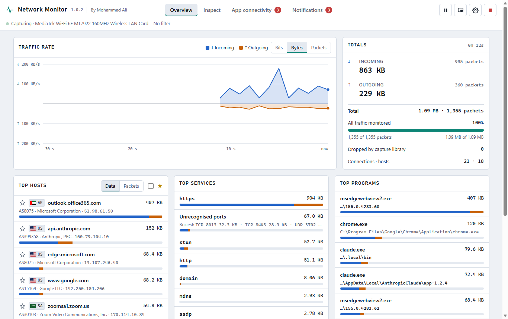

**Start page:** pick an adapter (busiest first) or open a capture file, with filters and optional export.

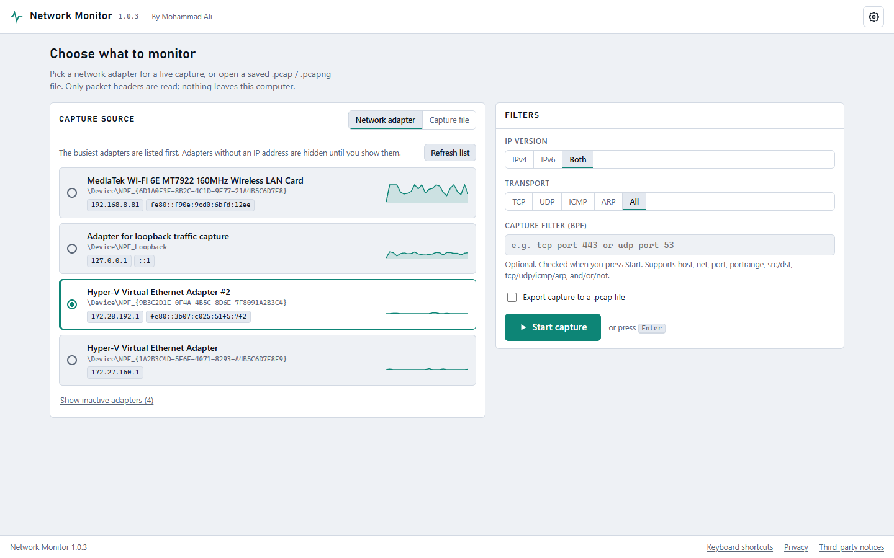

**Top hosts, services and programs:** country flags and network owners, "Unrecognised ports", programs grouped by file.

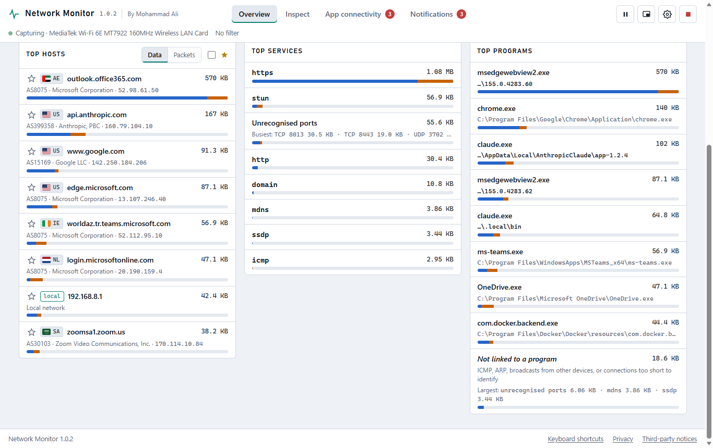

**Inspect:** every connection, with filters and sorting.

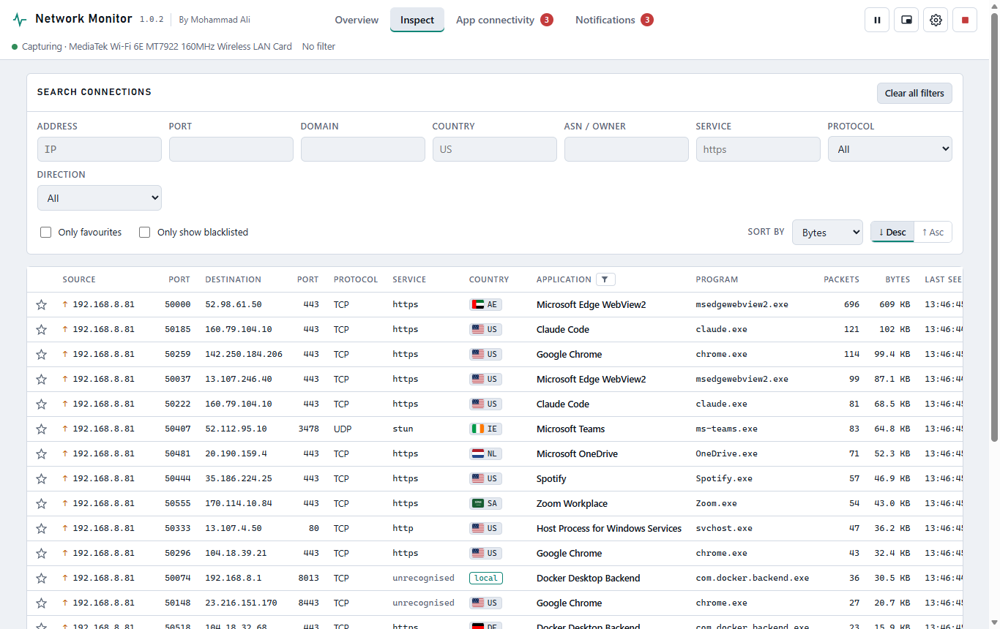

**App connectivity:** where each connection stops on its way out: name lookup, firewall, connect, proxy, HTTPS.

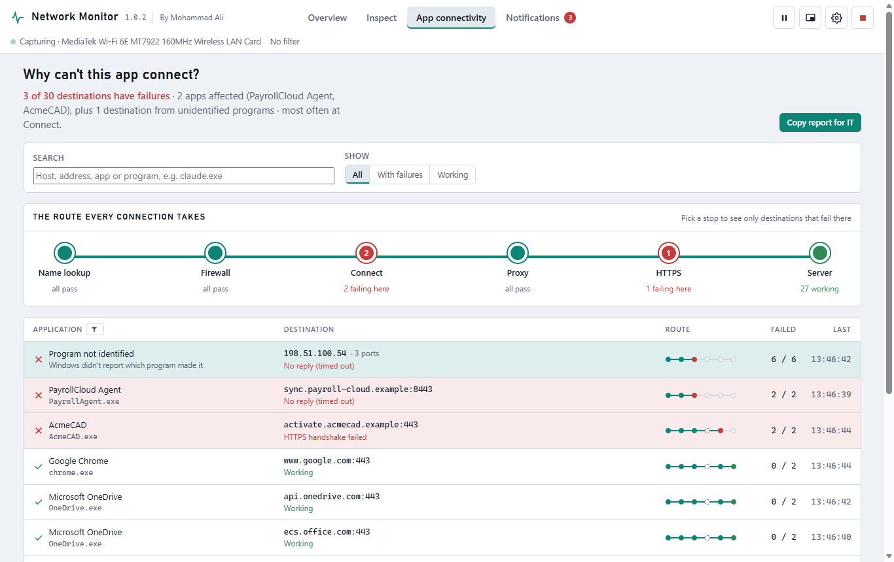

**Destination details:** what failed, the likely cause, what to do, and each step of the last attempt.

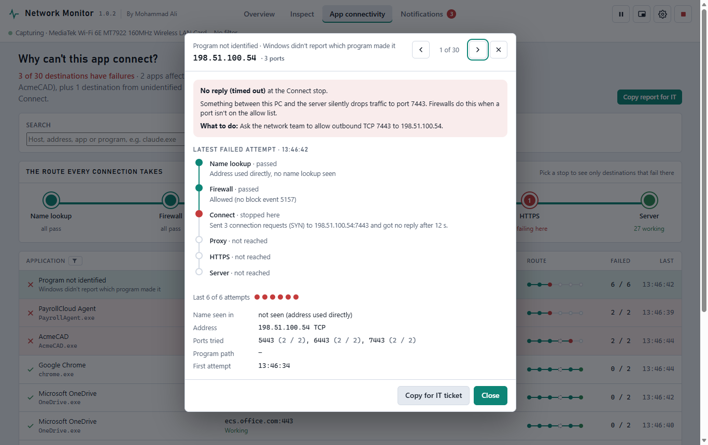

**Settings → Appearance:** 13 themes, custom palette and interface scale.

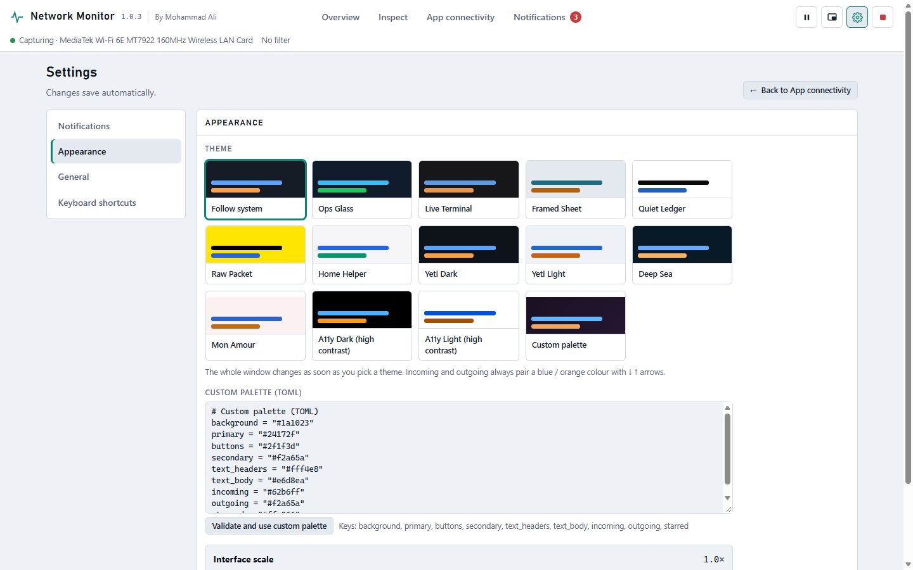

**Live Terminal theme**

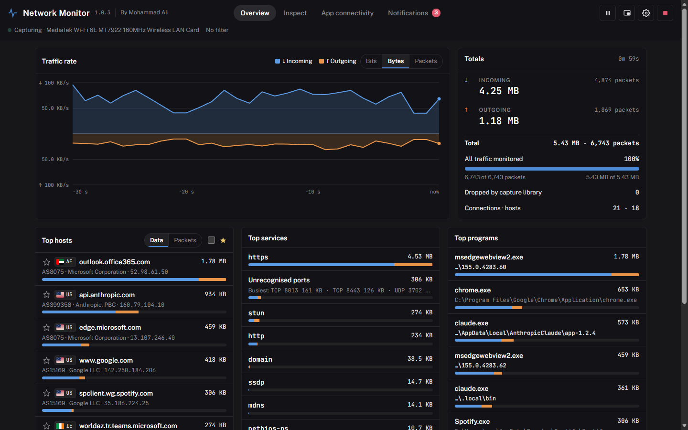

**Home Helper theme**

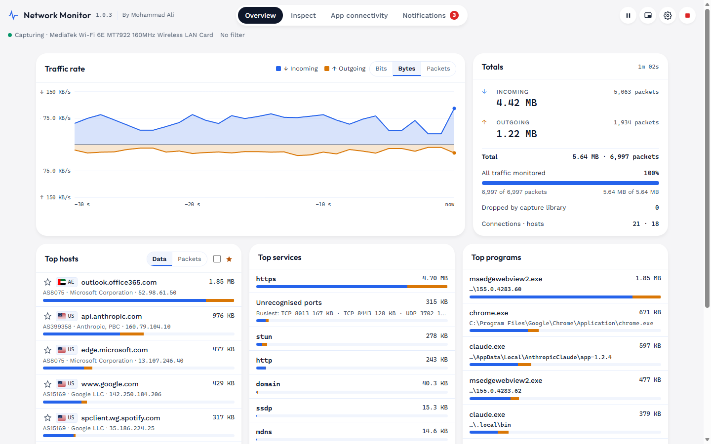

**Ops Glass theme**

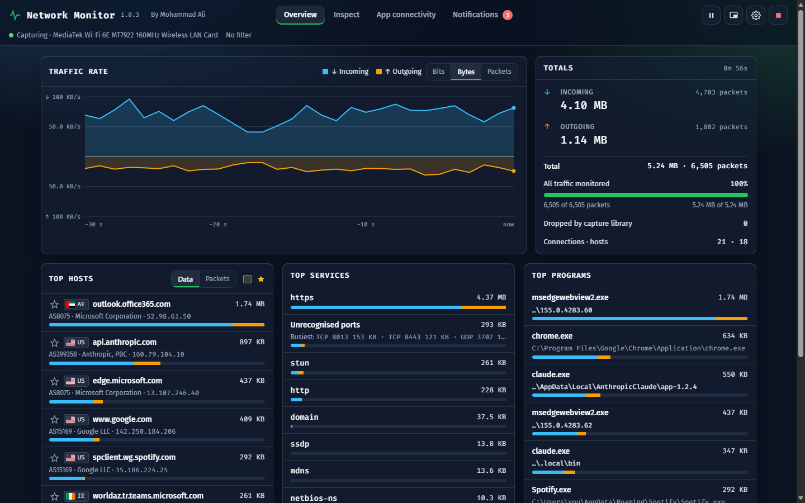

**Arabic:** the interface in Arabic, laid out right to left.

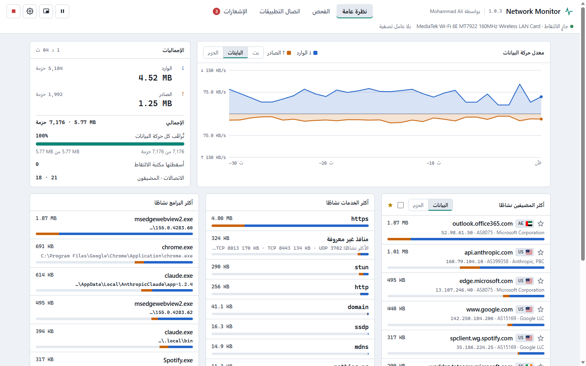

## Licence

MIT, see [LICENSE](LICENSE).

## Third-party components

See [THIRD-PARTY-NOTICES.txt](THIRD-PARTY-NOTICES.txt). Location data: IP Geolocation by [DB-IP](https://db-ip.com), licensed under [CC BY 4.0](https://creativecommons.org/licenses/by/4.0/).
