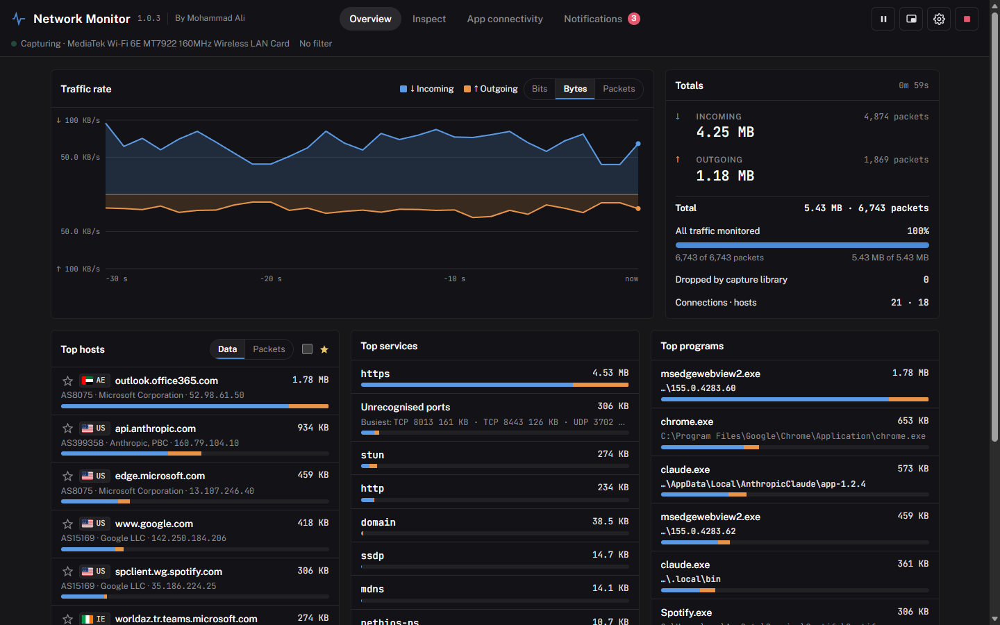
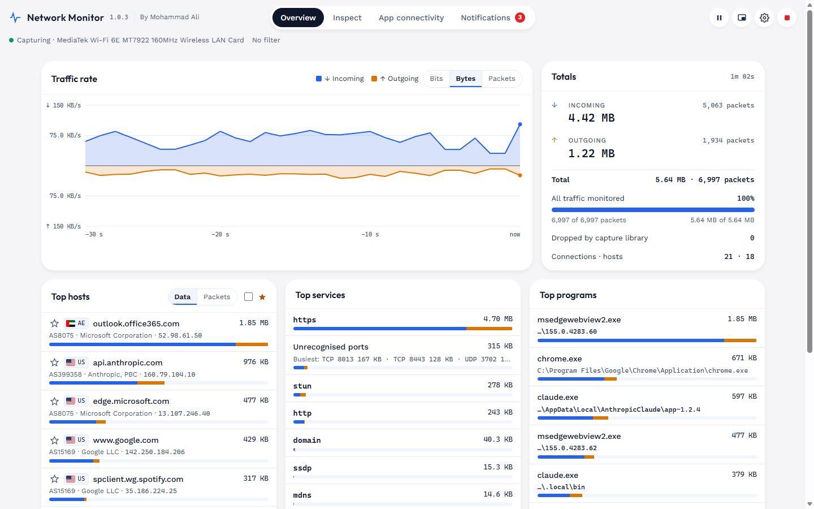

# Network Monitor

A Windows desktop app that shows what your PC is talking to on the network, and why an app can't connect.

By Mohammad Ali.

## Download

Get **NetworkMonitor-1.0.3-x64.msi** from the [Releases](../../releases) page and run it. It replaces any earlier 1.0.x.

- Windows 10 or 11, 64-bit.
- Live capture needs the free [Npcap](https://npcap.com) driver. The installer offers to download it; saved `.pcap` / `.pcapng` files open without it.
- The installer is not code-signed yet, so Windows SmartScreen may warn before it runs.

SHA-256 of `NetworkMonitor-1.0.3-x64.msi`:

```
68EC73E34CE9883440CF34714596C6639B740D4B0429B29385B3D9604DA2F462
```

## What it does

- **Overview:** live traffic chart, totals, and the busiest hosts (with country flag and network owner), services and programs.
- **Inspect:** every connection, with filters for address, port, country, service, program and direction.
- **App connectivity:** follows each connection through name lookup, Windows Firewall, connect, proxy and HTTPS, shows where it stops and what to do about it, and copies a report for IT.
- **Notifications:** data thresholds, favourite hosts, an IP blacklist, app connection failures, optional webhook. Each type can pop up or just be recorded.
- Pause and resume, thumbnail mode, English and Arabic (right-to-left), 13 themes.

All analysis happens on your PC. There is no telemetry and no account.

## What's new in 1.0.3

### New

- **Five new themes:** Live Terminal, Framed Sheet, Quiet Ledger, Raw Packet and Home Helper, each with its own fonts and shapes.
- **Pop-up per notification type:** choose for each type whether it pops up or is only recorded on the Notifications page.
- **Security hardening:** exports can't be redirected through links or junctions, webhooks don't follow redirects, and input from the interface is size-checked.

### Fixed

1.0.3 was tested for long runs, heavy traffic, large and damaged capture files, network changes, sleep and administrator use. These problems were found and fixed:

| Problem | Fixed in 1.0.3 |
|---|---|
| After many hours of capturing, the window could run out of memory and show a blank "page is having a problem" screen. | The window reloads itself within a second and keeps the running capture and your settings. Capturing never stops. A message says the view was reset. |
| Memory kept growing during long sessions. | Connections idle for 30 minutes are removed from the lists. Their traffic stays in the totals. |
| The interface slowed down as the number of connections grew. | Updates take about a quarter of the time they did on large sessions. |
| Under very heavy traffic (tens of thousands of new connections a second), the display fell behind. | The display keeps up in real time and uses less memory. |
| Updates could arrive late or bunched, and the chart was wrong after the PC slept. | Updates arrive every second without drift; sleep shows as a gap in the chart. |
| A large IP blacklist could stop settings from saving, without telling you. | The blacklist is stored in its own file, and you're told if anything can't be saved. |
| A failure storm could produce thousands of notifications a minute. | At most one pop-up per type every 5 seconds; the rest are combined into one ("12 more connection failures"). |
| Exporting to a .pcap file grew one file without limit until the disk filled. | A new file is started every 500 MB, and the export stops with a message when less than 1 GB is free. |
| A capture file cut off in the middle was replayed without warning. | You're told the file ends mid-packet and how many packets were read. |
| Running as administrator left a temporary browser profile (up to 45 MB) behind. | It's deleted when the app closes. |
| App connectivity: clicking the **Server** stop didn't filter the list. | It now shows the destinations that worked. |
| App connectivity: large counts overflowed the route circles. | Counts are shortened (20k, 1.4M), with the full number on hover. |
| App connectivity: the summary listed every affected app and became hard to read. | It names the top 3 apps and "and N more". |

## Screenshots

Version 1.0.3 running on sample traffic.

**Overview:** traffic chart, totals, top hosts, services and programs.


**Start page:** pick an adapter (busiest first) or open a capture file, with filters and optional export.


**Top hosts, services and programs:** country flags and network owners, "Unrecognised ports", programs grouped by file.


**Inspect:** every connection, with filters and sorting.


**App connectivity:** where each connection stops on its way out: name lookup, firewall, connect, proxy, HTTPS.


**Destination details:** what failed, the likely cause, what to do, and each step of the last attempt.


**Settings → Appearance:** 13 themes, custom palette and interface scale.


**Live Terminal theme**



**Home Helper theme**



**Ops Glass theme**


**Arabic:** the interface in Arabic, laid out right to left.


## Licence

MIT, see [LICENSE](LICENSE).

## Third-party components

See [THIRD-PARTY-NOTICES.txt](THIRD-PARTY-NOTICES.txt). Location data: IP Geolocation by [DB-IP](https://db-ip.com), licensed under [CC BY 4.0](https://creativecommons.org/licenses/by/4.0/).
